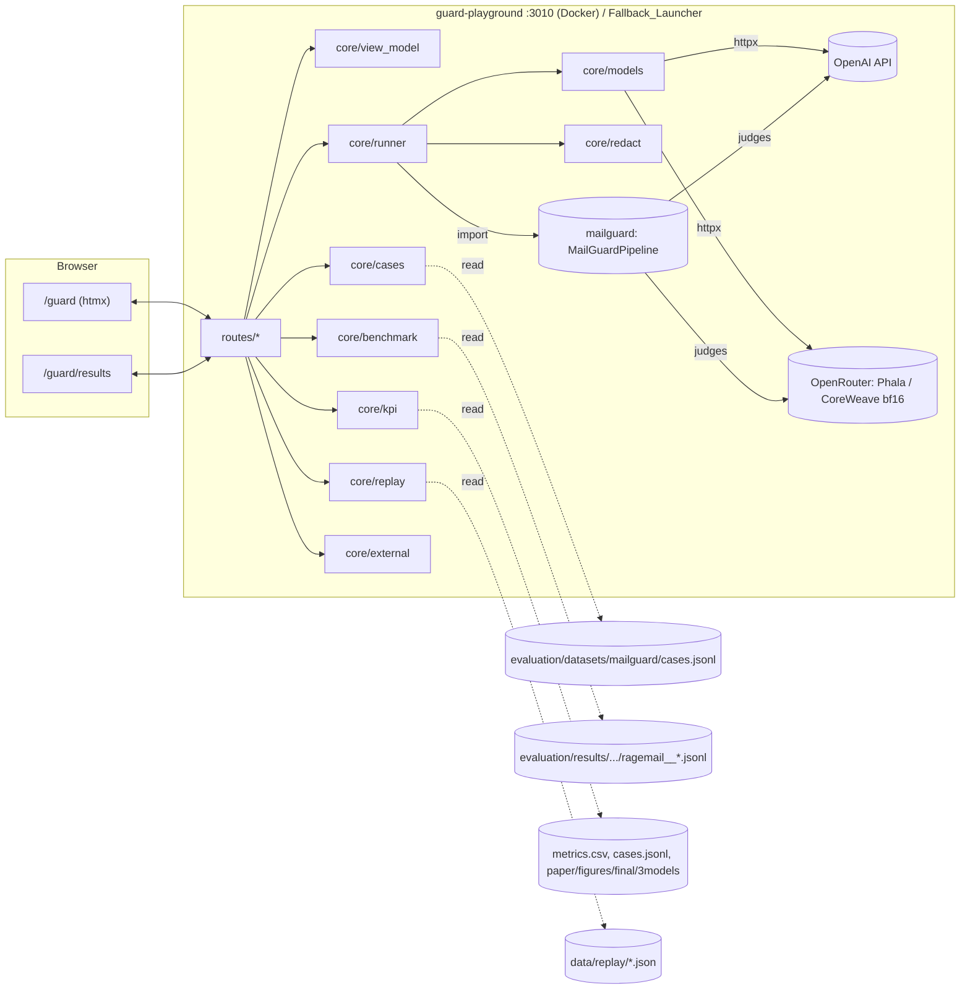

# Design Document: Guard Playground

## Overview

Guard Playground là ứng dụng FastAPI riêng (`services/guard_playground/`) để trình diễn AgentMailGuard trước hội đồng ngày 28/10/2026. Ứng dụng import trực tiếp thư viện guard (`mailguard.pipeline.MailGuardPipeline`), chạy một email qua 1–2 Preset, rồi dựng một **view model** (Outcome_Banner, Pipeline_Stepper, Layer rows, Evidence_Highlight, ngưỡng) để render bằng Jinja2 + htmx.

Có hai nguồn kết quả, cùng một schema `RunResult`:

- **Live**: chạy guard thật, Draft_Agent gọi một trong 3 model.
- **Replay**: đọc `RunResult` đã lưu trong `services/guard_playground/data/replay/`.

Mọi thứ hiển thị đều đi qua `RunResult`, nên Live và Replay dùng chung template và chung test.

Thiết kế này bám đúng các quyết định D1–D8 trong `requirements.md`. Các quyết định kỹ thuật mới được đánh số **TD1–TD8** ở mục cuối.

## Architecture



Mũi tên nét đứt là chỉ đọc. Playground_Service không ghi file nào ngoài `data/replay/`, và chỉ ghi vào đó khi chạy script `build_replay.py`.

### Cấu trúc thư mục

```
services/guard_playground/
  __init__.py
  main.py                 create_app(settings, *, runner=None) -> FastAPI
  settings.py             PlaygroundSettings (pydantic-settings, env prefix PLAYGROUND__)
  routes/
    pages.py              GET /guard, GET /guard/results, GET /guard/figures/{name}
    runs.py               POST /guard/run, GET /guard/runs/{run_id}, GET /guard/progress/{run_id}
    cases.py              GET /guard/cases (htmx list), GET /guard/cases/{case_id}
    external.py           POST /guard/upload, POST /guard/batch, GET /guard/batch/{id}, POST /guard/batch/{id}/stop, POST /guard/external/clear
    health.py             GET /healthz, GET /readyz
  core/
    cases.py  runner.py  models.py  replay.py  benchmark.py  kpi.py
    external.py  redact.py  view_model.py  highlight.py  policy_text.py  schema.py
  templates/guard/
    base.html  playground.html  results.html
    _case_list.html  _case_detail.html  _column.html  _stepper.html
    _layers.html  _progress.html  _batch.html  _benchmark.html  _kpi.html
  static/
    playground.css  playground.js        (review.css + htmx.min.js mount từ services/frontend/static)
  data/
    demo_set.json  demo_tour.json  replay/<case_id>__<preset>__<model_key>.json
scripts/playground/
  run_playground.ps1      -ReplayOnly: chạy bằng Python trên máy, không Docker
  build_replay.py         --model {gpt-4o-mini|qwen|llama|all} [--cases ...] [--presets ...]
tests/unit/
  test_guard_playground_routes.py  test_guard_playground_view_model.py
  test_guard_playground_highlight.py  test_guard_playground_replay.py
  test_guard_playground_external.py  test_guard_playground_safety.py
  test_guard_playground_kpi.py
```

## Components and Interfaces

### `settings.py`

```python
class PlaygroundSettings(BaseSettings):
    model_config = SettingsConfigDict(env_prefix="PLAYGROUND__", env_nested_delimiter="__")
    host: str = "127.0.0.1"
    port: int = 3010
    live_enabled: bool = True                 # False khi chạy qua Fallback_Launcher (-ReplayOnly)
    repo_root: Path = Path("/app")            # /app trong container; thư mục repo khi chạy trên máy
    guard_root: Path                          # <repo_root>/agentmailguard
    cases_path: Path                          # evaluation/datasets/mailguard/cases.jsonl
    fixtures_path: Path                       # agentmailguard/tests/fixtures/emails.json
    results_root: Path                        # evaluation/results/mailguard_bench
    figures_dir: Path                         # paper/figures/final/3models
    data_dir: Path                            # services/guard_playground/data
    l1_model_path: Path                       # PLAYGROUND__L1_MODEL_PATH
    run_timeout_s: float = 120.0
    batch_concurrency: int = 2
    max_upload_bytes: int = 5 * 1024 * 1024
    max_batch_emails: int = 50
```

Khóa API **không** nằm trong settings. `core/models.py` đọc chúng từ biến môi trường lúc gọi model:
- `OPENAI_API_KEY`, nếu không có thì `BENCH_OPENAI_API_KEY`;
- `BENCH_OPENROUTER_API_KEY`.

Như vậy khóa không bao giờ có mặt trong bất kỳ object nào được render.

### `core/models.py` — 3 Draft_Model

```python
@dataclass(frozen=True)
class DraftModel:
    key: Literal["gpt-4o-mini", "qwen", "llama"]
    label: str                 # "gpt-4o-mini", "Qwen2.5-7B-Instruct", "Llama-3.1-8B-Instruct"
    model_id: str              # "gpt-4o-mini" | "qwen/qwen-2.5-7b-instruct" | "meta-llama/llama-3.1-8b-instruct"
    route_label: str           # "OpenAI API" | "OpenRouter, Phala" | "OpenRouter, CoreWeave, bf16"
    base_url: str              # https://api.openai.com/v1 | https://openrouter.ai/api/v1
    key_env: tuple[str, ...]   # tên biến môi trường chứa khóa, theo thứ tự ưu tiên
    provider_routing: dict | None   # sao chép đúng từ evaluation/mailguard_bench/guard_models.yaml

DRAFT_MODELS: tuple[DraftModel, ...]           # thứ tự cố định gpt-4o-mini, qwen, llama
def credential_present(m: DraftModel) -> bool
def guard_providers(m: DraftModel) -> GuardProviders      # OpenAIProvider(model, base_url, api_key, routing)
def draft_agent(m: DraftModel, *, timeout_s: float) -> DraftFactory
```

**TD1. Judge của guard dùng cùng model với Draft_Model (D9, đã chốt).** Benchmark làm đúng như vậy: `guard_factory.guard_settings` đặt cả 5 judge lên `model_name` của run, và `manifest.json` của cả ba lần chạy 19/10 ghi cả 5 judge ở C3 đều là model của run. Settings của guard tạo theo đúng `guard_settings` (doc judge, set judge, output judge bật như benchmark C3 đã chạy), và `RunResult.guard_models` ghi lại model của từng judge.

**TD2. Truyền provider trực tiếp, không qua biến môi trường.** `MailGuardPipeline` nhận sẵn các tham số `inbound_judge`, `doc_judge`, `doc_set_judge`, `output_judge`, `extractor_llm` (xem `pipeline.py`). Playground tự dựng `OpenAIProvider(model, base_url, api_key, provider_routing, response_metadata=True)` cho từng model. Nhờ vậy:
- không phải đổi `OPENAI_BASE_URL` giữa các Run;
- OpenAI và OpenRouter chạy song song được trong cùng một tiến trình;
- không cần sửa `models.yaml`.

`draft_agent()` gửi cùng `messages` mà guard dựng, nhận JSON trả lời và chuyển thành `DraftCandidate(body, action, citations, model_name)`. Phần định tuyến đi theo đúng `provider_routing` của benchmark.

### `core/runner.py`

```python
@dataclass
class RunRequest:
    input: EmailInput            # subject, body, chunks[], source: "pinned"|"fixture"|"custom"|"external", case_id?
    preset: str                  # một trong 9 Preset
    model_key: str
    mode: Literal["live", "replay"]

class RunRegistry:              # trong bộ nhớ, theo session cookie
    def start(self, req: RunRequest) -> str               # run_id; tạo asyncio.Task
    def status(self, run_id: str) -> RunStatus            # running(stage, elapsed_s) | done(RunResult) | failed(category, message) | timeout
    def cancel(self, run_id: str) -> None

async def execute(req: RunRequest, *, settings, progress: Callable[[str], None]) -> RunResult
```

`execute()` làm theo thứ tự:
1. `GuardConfig.preset(req.preset)`, rồi `MailGuardPipeline(config=..., settings=guard_settings(...), audit=False, **providers)`.
2. `await asyncio.wait_for(pipeline.run(email, chunks, agent, system_instructions=SYSTEM), timeout=120)`.
3. `RunResult.from_guard(report, draft, bundle, ...)`.
4. Đưa kết quả qua `redact()` trước khi trả về.

`audit=False` là bắt buộc (Requirement 9.4). Có test bọc constructor để kiểm tra điều này.

**Tiến trình theo stage (Requirement 20).** Guard không có hook cho từng stage, và ta không được sửa guard. Vì vậy `execute()` bọc từng provider và agent bằng một wrapper ghi lại stage đang gọi:
- inbound judge hoặc extractor ứng với "L1 Inbound Guard";
- doc judge ứng với "L2 Doc Scanner";
- agent ứng với "Generation";
- output judge ứng với "L4 Output Guard".

Thời gian chạy tính từ lúc bắt đầu. Các stage không gọi LLM, như L3 Gate và Channel isolation, chạy xong trong vài mili giây nên không hiện riêng. Đây là giới hạn đã biết và chấp nhận được (TD6).

`RunResult` của C0 vẫn đi qua `MailGuardPipeline` với preset C0: mọi layer tắt, isolation tắt, prompt nối thẳng. Cách này giống C0T của benchmark. Nó **không** phải pipeline gốc của rag-email (C0 benchmark), và giao diện ghi rõ "C0 (guard template, no layer)" (TD3).

### `core/schema.py` — `RunResult` (Replay_Store schema v1)

```python
class Finding(BaseModel):     detector: str; rule_id: str | None; score: float; technique: str | None; excerpt: str
class LayerRow(BaseModel):    layer: Literal["inbound_guard","doc_scanner","output_guard"]; ran: bool
                              not_run_reason: Literal["disabled by preset","stopped by policy"] | None
                              severity: str; score: float; decided_by: str; latency_ms: int
                              findings: list[Finding]; error: str | None; fallback_reason: str | None
                              judge_configured: bool
class Stripped(BaseModel):    text: str; reason: str; score: float | None
class ChunkRow(BaseModel):    chunk_id: str; content: str; score: float | None; quarantined: bool
                              reason_rule_id: str | None; reason_technique: str | None
class Decision(BaseModel):    action: str; matched_rule_id: str; risk_tier: str; requires_human: bool
class Thresholds(BaseModel):  block: float | None; flag: float | None; strip: float | None; quarantine: float | None
class RunResult(BaseModel):
    schema_version: Literal[1] = 1
    generated_at: datetime            # UTC
    mode: Literal["live", "replay"]
    source: Literal["pinned", "fixture", "custom", "external"]
    case_id: str | None
    preset: str
    draft_model: str                  # key của DraftModel
    guard_models: dict[str, str]      # judge -> model id (TD1)
    email: EmailInput
    layers: list[LayerRow]            # luôn đủ 3 dòng, theo thứ tự pipeline
    user_intent: str | None
    stripped: list[Stripped]; removed_ratio: float
    chunks: list[ChunkRow]; quarantine_ratio: float
    inbound: Decision | None; outbound: Decision | None
    gate_passes: int | None           # report.metadata["gate_passes"]
    isolation_applied: bool
    draft_generated: bool; draft_body: str | None    # draft sau L4; None khi bị chặn ở cửa vào
    guarded_prompt: str | None        # bundle.messages[1].content
    thresholds: Thresholds
    error: str | None = None
```

- `RunResult` là schema Pydantic đóng (`extra="forbid"`). Replay đọc file bằng `RunResult.model_validate_json`, file nào sai schema thì bỏ qua (Requirement 7.12).
- Tên file `<case_id>__<preset>__<model_key>.json`. `generated_at` và `draft_model` nằm bên trong file.
- `final_decision` không lưu, mà tính ra từ dữ liệu: `outbound or inbound`. Nhờ vậy không thể có hai giá trị mâu thuẫn nhau.

### `core/view_model.py` — dữ liệu cho template

```python
@dataclass
class ColumnView:
    banner: Banner                 # text, icon, css, rule_id, reason, score_line
    stepper: list[StageView]       # đúng 7 stage
    layers: list[LayerView]        # có cờ expanded (Deciding_Layer)
    highlighted_body: Markup; highlighted_chunks: list[ChunkView]
    draft: DraftView               # nhãn, nội dung hoặc lời "No draft was generated"
    label: str                     # "C3 · REPLAY · gpt-4o-mini · generated 2026-10-26 14:05"
def build_column(r: RunResult, policy: PolicyText) -> ColumnView
```

**Outcome_Banner (Requirement 12).**

| Final action | Text | Icon (khác hình nhau) | CSS |
|---|---|---|---|
| block | BLOCKED | ⛔ octagon | `banner--block` |
| quarantine | QUARANTINED | ▣ filled square | `banner--quarantine` |
| human_approval | NEEDS HUMAN REVIEW | ◆ diamond | `banner--review` |
| draft_only | DRAFT ONLY | ● circle | `banner--draft` |
| auto_send | AUTO-SEND | ▲ triangle | `banner--send` |
| (không có quyết định) | NO GUARD DECISION | ○ ring | `banner--none` |

- Icon dùng SVG nội tuyến, có `aria-label` bằng đúng chữ trên banner. Chữ trên banner dùng màu `#1b1b1f` hoặc `#fff`, nền có độ tương phản ít nhất 4.5:1.
- `reason` lấy từ `policy_text.reason(rule_id)`, đọc `agentmailguard/configs/policy.yaml` một lần khi khởi động. Không tìm thấy thì ghi "rule reason not found".
- `score_line` chỉ có khi Deciding_Layer là L1 hoặc L2 (Requirement 15.7, 15.8).

**Deciding_Layer:** layer có severity cao nhất khác `none`; nếu bằng nhau thì lấy layer chạy sau. Section của layer đó mở sẵn, các section khác thu gọn.

**Stage_Status (Requirement 13).** Hàm thuần `stages(r: RunResult) -> list[StageView]`:

```
S = [L1, G1, L2, G2, ISO, GEN, L4]            # G = L3 Inbound Gate pass 1/2
enabled(s) = theo preset; GEN luôn enabled
stop_at = None
if final.action in {block, quarantine}:
    if outbound and outbound.action in {block,quarantine}: stop_at = L4
    elif gate_passes == 1: stop_at = G1
    else: stop_at = G2
for s in S:
    if not enabled(s): status = "disabled by preset"
    elif stop_at and index(s) > index(stop_at): status = "skipped"
    elif s == stop_at: status = "stopped here"
    elif s in {L1, L2, L4} and (severity != none or (s==L1 and stripped) or (s==L2 and quarantined)): "flagged"
    else: "passed"   (L2 có 0 chunk thì kèm ghi chú "0 chunks scanned")
```

Thuật toán này bảo đảm mỗi Run có nhiều nhất một stage "stopped here", và không stage nào bên trái stage đó bị đánh "skipped" (Property 3).

### `core/highlight.py` — Evidence_Highlight (Requirement 14)

```python
def spans(text: str, needles: list[Needle]) -> list[Span]   # Needle: (text, ref_id); Span: (start, end, refs)
def render(text: str, spans: list[Span]) -> Markup
```

1. Bỏ qua needle rỗng hoặc chỉ có khoảng trắng; những needle này nhận ghi chú "excerpt not located in the shown text".
2. Với mỗi needle, tìm **mọi** vị trí trùng khớp chính xác, phân biệt hoa thường, trên văn bản thô (`str.find` lặp). Needle không có vị trí nào thì nhận cùng ghi chú trên.
3. Sắp xếp các khoảng theo vị trí bắt đầu rồi gộp những khoảng **giao nhau**: một khoảng bắt đầu trước khi khoảng trước kết thúc thì nhập làm một và hợp danh sách tham chiếu. Hai khoảng chỉ chạm nhau thì giữ riêng.
4. `render`: duyệt văn bản theo từng đoạn. Đoạn thường thì `escape(segment)`. Đoạn được tô thì bọc trong `<mark class="ev" id="ev-..."><span aria-hidden="true">⚑</span>` + `escape(segment)` + `<a href="#f-...">L1 · R12</a></mark>`.

Mọi phần chữ đều đi qua `markupsafe.escape`. HTML duy nhất xuất hiện trong kết quả là thẻ do code tạo ra. Như vậy bỏ hết thẻ đi thì còn lại đúng `escape(text)` (Property 4, 5).

### `core/cases.py`, `core/benchmark.py`, `core/kpi.py`

```python
def load_cases(settings) -> CaseCatalog          # pinned + fixtures; bỏ dòng hỏng, đếm số dòng hỏng
def demo_set(settings) -> list[str]              # đọc demo_set.json
def benchmark_records(case_id, presets) -> BenchmarkTable   # 3 model × preset; "no record" | "record unreadable"
def kpi(settings) -> KpiStrip                    # 3 thẻ × 3 model, theo Requirement 18
```

- `CaseCatalog` dựng một lần khi khởi động: khoảng 1,800 dòng, đọc mất dưới 1 giây.
- Thứ tự ưu tiên khi đọc kind và source của một case: `kind` và `vector` trước, rồi `source`. Ánh xạ: `kind == "benign"` thành `benign`; `vector == "rag"` thành `rag_poison`; còn lại là `attack`.
- `benchmark_records` lập chỉ mục từng file `ragemail__<config>.jsonl` theo `case_id` khi được gọi lần đầu, rồi giữ trong bộ nhớ (LRU). Chỉ đọc.
- Thư mục run được ánh xạ sang model bằng tên thư mục: `gpt4omini`, `qwen25-7b`, `llama31-8b`.

### `core/external.py` (Requirement 21)

```python
def parse_upload(filename: str, data: bytes) -> ParseResult   # emails[], excluded[(pos, id, rule)], error?
class BatchRegistry:  start(emails, presets, model_key) -> batch_id; status(id); stop(id)
```

- **`.eml`:** đọc bằng `email.message_from_bytes(policy=policy.default)`. Lấy `get_body(("plain",))`; không có thì lấy phần `html` rồi bỏ thẻ bằng `html.parser`.
- **`.json` và `.jsonl`:** nhận dạng tối giản hoặc dạng case của benchmark.
- **Giới hạn:** tối đa 5 MB và 50 email mỗi file. Giới hạn của từng email theo Requirement 8.5.
- **Chạy lô:** dùng `asyncio.Semaphore(2)`. Mỗi email chạy qua `RunRegistry.execute`.
- **Lưu trữ:** chỉ trong bộ nhớ, theo session cookie. Không ghi file.

### `core/redact.py`

```python
def secrets() -> list[str]          # giá trị của mọi biến môi trường có tên kết thúc bằng _KEY, _TOKEN, _SECRET, _PASSWORD, dài >= 8
def redact(s: str) -> str           # thay mỗi giá trị khóa bằng "[redacted]"
class RedactingFilter(logging.Filter)
```

`redact` được áp lên:
- mọi thông báo lỗi trước khi render;
- mọi `RunResult` trước khi trả về hoặc ghi ra file Replay;
- mọi dòng log, thông qua một filter gắn vào root logger.

### Routes và htmx

| Route | Trả về | Ghi chú |
|---|---|---|
| `GET /guard` | trang đầy đủ | mặc định Replay, so sánh C0 và C3, Draft_Model gpt-4o-mini |
| `GET /guard/cases?kind=&source=` | `_case_list.html` | `hx-trigger="change"` trên 2 ô lọc |
| `GET /guard/cases/{id}` | `_case_detail.html` | nạp email và chunk của case vào form (hidden) |
| `POST /guard/run` | 2 khung `_progress.html` (Live) hoặc 2 `_column.html` (Replay) | kiểm tra giới hạn đầu vào trước khi chạy |
| `GET /guard/progress/{run_id}` | `_progress.html` hoặc `_column.html` | `hx-trigger="every 1s"`; khi xong trả cột kết quả và dừng polling |
| `POST /guard/upload` | form điền sẵn (1 email) hoặc khung chạy lô | chỉ ở Live |
| `POST /guard/batch`, `GET /guard/batch/{id}` | `_batch.html` | polling mỗi 2 s |
| `GET /guard/results` | `results.html` | KPI và 6 hình |
| `GET /guard/figures/{name}` | file PNG hoặc PDF | `name` phải nằm trong danh sách cho phép fig1..fig6 |
| `GET /healthz`, `/readyz` | JSON | readyz báo guard import được không, có case không, có Replay không |

**Khóa điều khiển khi đang chạy:** form có `hx-disabled-elt="find button, find select, find input[name=mode]"`, nên nút chạy, ô chọn preset, ô chọn model và công tắc chế độ đều bị khóa trong lúc Run đang chạy (Requirement 3.8, 7.8).

### Docker và launcher

```yaml
  guard-playground:
    build: *app-build                  # cùng image, không sửa Dockerfile/.dockerignore
    container_name: rag-email-guard-playground
    command: ["python", "-m", "uvicorn", "services.guard_playground.main:app", "--host", "0.0.0.0", "--port", "3010"]
    ports: ["127.0.0.1:3010:3010"]      # chỉ máy local (ADR-0009)
    environment:
      PYTHONPATH: /app:/app/agentmailguard
      PLAYGROUND__REPO_ROOT: /app
      PLAYGROUND__L1_MODEL_PATH: /artifacts/l1_injection_clf_v1.joblib
      OPENAI_API_KEY: ${BENCH_OPENAI_API_KEY:-}
      BENCH_OPENROUTER_API_KEY: ${BENCH_OPENROUTER_API_KEY:-}
    volumes:
      - ./agentmailguard:/app/agentmailguard:ro
      - ./evaluation/datasets:/app/evaluation/datasets:ro
      - ./evaluation/results:/app/evaluation/results:ro
      - ./paper/figures/final:/app/paper/figures/final:ro
      - ./services/guard_playground:/app/services/guard_playground:ro
      - ${PLAYGROUND_ARTIFACTS_DIR:-C:/AgentMailGuard-bench-artifacts}:/artifacts:ro
    restart: "no"
```

**TD4. Gắn `agentmailguard/` vào container và đưa nó vào `PYTHONPATH`.**
- Không cần sửa image. Image đã có sẵn các thư viện guard cần, theo `pyproject.toml` ở gốc: pydantic, httpx, scikit-learn, numpy, joblib; còn pyyaml thì cần kiểm tra lại.
- Venv của image khóa scikit-learn đúng 1.9.1 qua `uv.lock`, khớp với classifier L1 đã train.
- `services/guard_playground` cũng được gắn vào ở dạng chỉ đọc. Lý do: image hiện tại chỉ có thư mục `services/` lúc build, nên Playground chạy được mà không cần build lại image, kể cả đúng sáng ngày bảo vệ.
- Không đặt `depends_on`, nên Playground chạy được khi các service khác của stack đang tắt (Requirement 9.10).

**`run_playground.ps1 -ReplayOnly`** chạy:
```
uv run --project . --with-editable agentmailguard python -m uvicorn services.guard_playground.main:app --host 127.0.0.1 --port 3010
```
với `PLAYGROUND__LIVE_ENABLED=false`. Script chờ `/readyz` trả về được rồi in đường dẫn `http://127.0.0.1:3010/guard`.

## Data Models

Dữ liệu cấu hình của Playground nằm trong `services/guard_playground/data/`:

```json
// demo_set.json
{"cases": ["benign-llmailfp-12", "attack-llmail-…", "attack-prag-nq-…", "attack-seedrag-P02-…", "attack-synthetic-v1-returns-03", "…"]}

// demo_tour.json  (Requirement 17: 4–6 bước)
{"steps": [
  {"input": {"case_id": "benign-llmailfp-12"}, "presets": ["C0","C3"], "mode": "replay",
   "talking_point": "A normal customer email passes the full guard unchanged."},
  {"input": {"case_id": "attack-llmail-…"}, "presets": ["C0","C3"], "mode": "replay",
   "talking_point": "This email hides an instruction to mail the attacker; L1 stops it."},
  {"input": {"case_id": "attack-prag-nq-…"}, "presets": ["C0","C3"], "mode": "replay",
   "talking_point": "A poisoned knowledge passage makes the model answer wrongly; L2 quarantines it."},
  {"input": {"case_id": "attack-seedrag-P02-…"}, "presets": ["C0","C3"], "mode": "replay",
   "talking_point": "A planted link in the knowledge base is caught before the reply is drafted."},
  {"input": {"custom": {"subject": "Refund", "body": "…"}}, "presets": ["C0","C3"], "mode": "live",
   "talking_point": "The committee can try its own wording live."}
]}
```

Cách chọn Demo_Set dựa trên dữ liệu benchmark: dùng `benchmark.py` tìm các case mà ở C0 `goal_achieved=true` và ở C3 bị chặn, với cả 3 model nếu có. Cụ thể:
- 3 email tấn công LLMail;
- 3 case PoisonedRAG;
- 2 case seed;
- 2 case synthetic;
- 3 email benign mà C3 không chặn;
- 1 email Enron bị C3 chặn nhầm (false positive), để trung thực với hội đồng.

Tổng cộng 14 case. Script `build_replay.py --list-candidates` in danh sách ứng viên để nhóm chọn.

**Dung lượng Replay:** 14 case × 9 preset × 3 model = 378 file, mỗi file khoảng 5–15 KB, tổng khoảng 4 MB. Mặc định script chỉ tạo các preset mà Demo_Tour và nút so sánh dùng tới: C0, C3, và 5 config ablation khi có `--presets all`.

## Page layout và UX

```
┌ header: AgentMailGuard Playground | [Playground] [Results] | (Review UI ↗)
├ toolbar: Mode [Replay|Live] · Model [gpt-4o-mini ▾] · Compare [C0 ▾] vs [C3 ▾] · [Presenter mode]
│          badge cố định: "REPLAY · generated 2026-10-26 14:05" hoặc "LIVE · Llama-3.1-8B-Instruct (OpenRouter, CoreWeave, bf16)"
├ tour bar (khi bật tour): Step 2 of 5 — "This email hides an instruction…"  [Prev] [Next] [Exit]
├ left rail (300px): Cases [kind ▾][source ▾] (count) · list ★ demo set  |  Custom email · Upload (Live)
├ main:
│   Email (thu gọn được), có tô sáng Evidence_Highlight · KB chunks (QUARANTINED gạch ngang)
│   ┌ Column C0 ──────────────┐ ┌ Column C3 ──────────────┐
│   │ [Outcome_Banner]        │ │ [Outcome_Banner]        │
│   │ [Pipeline_Stepper 7]    │ │ [Pipeline_Stepper 7]    │
│   │ Draft                   │ │ Draft / "No draft…"     │
│   │ ▸ L1 … ▸ L2 … ▸ L4 …    │ │ ▾ L1 (Deciding_Layer)   │
│   │ ▸ Guarded prompt        │ │ ▸ Guarded prompt        │
│   └─────────────────────────┘ └─────────────────────────┘
│   Recorded benchmark results (3 model × 2 preset)
└ KPI strip (3 thẻ) · Full results →
```

- **Kết luận đặt lên trước, chi tiết mở khi cần:** banner và dải stepper luôn hiện. Chi tiết từng layer và prompt nằm trong `<details>`, dùng phần tử native nên có sẵn trạng thái mở/đóng cho trình đọc màn hình, không cần JavaScript.
- **Hai cột:** `grid-template-columns: minmax(0,1fr) minmax(0,1fr)`. Cột trái bên lề co lại ở màn hình hẹp hơn 1440 px. Ở 1280 px vẫn đủ chỗ cho 2 cột, mỗi cột khoảng 470 px. Dải stepper có 7 ô, mỗi ô khoảng 64 px, nhãn được xuống tối đa 2 dòng.
- **Presenter mode:** thêm class `presenter` vào `<html>`. Đặt `--fs-body: 20px; --fs-h: 26px`, ẩn cột trái và thu gọn prompt. Lưu trạng thái trong `sessionStorage`, nhưng mặc định luôn tắt khi tải trang (Requirement 19.1). Phím tắt: `N`/`P` cho tour, `Shift+P` cho presenter mode.
- **Không dựa vào màu:** mỗi trạng thái stepper có biểu tượng và chữ riêng (✓ passed, ! flagged, ■ stopped here, – skipped, ∅ disabled by preset). Evidence có gạch chân và ký hiệu ⚑. Chunk bị cách ly có gạch ngang chữ và nhãn.
- **Font:** dùng `system-ui`. Chữ thường 18 px, tiêu đề 24 px, độ tương phản đạt AA. Viền focus dùng lại của `review.css`.

## Error Handling

| Tình huống | Hiển thị | Requirement |
|---|---|---|
| Không import được guard | `/guard` báo "Guard library unavailable"; `/healthz` vẫn chạy | 9.8 |
| Thiếu hoặc hỏng `cases.jsonl` | Ẩn danh sách case, báo tên file; Custom email vẫn dùng được | 1.5 |
| Dòng case hỏng | Bỏ dòng đó, cảnh báo "N lines excluded" | 1.7 |
| Lỗi API model | Phân loại theo lỗi httpx hoặc mã HTTP: connection, auth (401/403), rate limit (429), provider error (4xx/5xx khác); đã xóa khóa khỏi thông báo; có nút "Show replay" nếu có file Replay | 7.5, 7.6, 8.4 |
| Quá 120 s | "Run timed out after 120 seconds"; hủy task | 7.7 |
| Thiếu khóa của Draft_Model | Khóa nút chạy, ghi rõ model nào thiếu khóa | 7.16 |
| File Replay sai schema | Bỏ qua, hiện "replay unavailable" | 7.12 |
| Một cột của so sánh bị lỗi | Cột đó báo lỗi, cột kia vẫn hiện kết quả | 3.7, 5.8 |
| Không có kết quả benchmark hoặc file hỏng | Ô ghi "no record" hoặc "record unreadable" | 6.4, 6.7 |
| Thiếu hình | "figure not available: fig3_…png" | 18.14 |
| File tải lên không hợp lệ | Từ chối cả file với một thông báo; email hỏng trong file thì loại riêng từng email | 21.5, 21.6 |
| Chạy qua Fallback_Launcher | Công tắc Live bị khóa: "Live mode requires the Docker service" | 16.9 |

## Security

- **Chỉ chạy local:** `127.0.0.1:3010`, cả khi chạy trong Docker lẫn qua launcher. Không có đăng nhập, ghi rõ trong tài liệu của Playground.
- **Không lộ khóa:** khóa chỉ được đọc lúc gọi model, không lưu trong object nào được render. Có `redact()` áp lên lỗi, `RunResult` và log. Test đặt các giá trị khóa giả rồi kiểm tra chúng không xuất hiện ở bất kỳ đâu.
- **Escape:** Jinja2 bật autoescape. Riêng phần highlight được dựng bằng `Markup` từ các đoạn đã escape. Không có `|safe` nào trên dữ liệu người dùng nhập.
- **Không ghi gì:** không ghi DB, không ghi broker, không ghi `evaluation/results/`, `agentmailguard/` hay file tải lên. `audit=False`. Trong Docker, mọi thư mục dữ liệu đều được gắn ở dạng chỉ đọc, nên tầng hệ điều hành cũng chặn việc ghi.
- **Chặn truy cập file tùy ý:** `/guard/figures/{name}` chỉ trả về file nằm trong danh sách cho phép.
- **Không gửi thư:** Playground không import code gửi thư nào của rag-email. Draft chỉ nằm trên trang web.

## Testing Strategy

- **Test route** (`httpx.AsyncClient(transport=ASGITransport(app))`): theo đúng kiểu `tests/unit/test_frontend_review_ui.py`. App được tạo bằng `create_app(settings, runner=StubRunner)`. `StubRunner` trả về `RunResult` dựng sẵn và có thể giả lập lỗi, độ trễ hoặc quá thời gian.
- **Test pipeline:** dùng `MailGuardPipeline` thật với provider giả của guard (`FakeLLMProvider`) và agent giả. Không gọi mạng.
- **Chặn mạng:** một fixture vá `httpx.AsyncClient.send` để ném lỗi khi có lời gọi ra ngoài, áp cho mọi test của Playground.
- **Property tests:** dùng `hypothesis`. Repo hiện chưa có thư viện này, nên phải thêm vào dev dependency với phiên bản ghim, sau khi nhóm đồng ý (Câu hỏi mở 2).
- **Thời gian:** cả bộ test chạy dưới 60 giây (Requirement 11.9).

## Correctness Properties

*Property là một tính chất phải đúng với mọi lần chạy hợp lệ của hệ thống, tức một phát biểu hình thức về những gì hệ thống phải làm. Property là cầu nối giữa đặc tả mà người đọc được và bảo đảm đúng mà máy kiểm chứng được.*

### Property 1: Replay round-trip
*Với mọi* `RunResult` hợp lệ `r`, `RunResult.model_validate_json(r.model_dump_json()) == r`.
**Validates: Requirements 7.11**

### Property 2: Banner khớp với quyết định
*Với mọi* `RunResult` có quyết định cuối, chữ trên Outcome_Banner là ảnh của `final.action` qua đúng bảng ở Requirement 12.2. Với mọi `RunResult` không có quyết định, chữ là "NO GUARD DECISION".
**Validates: Requirements 12.2, 12.5**

### Property 3: Stepper nhất quán
*Với mọi* `RunResult`, dải stepper có đúng 7 stage, có nhiều nhất 1 stage "stopped here", có đúng 1 stage "stopped here" khi và chỉ khi `final.action` là block hoặc quarantine, không stage nào bên trái stage "stopped here" bị đánh "skipped", và stage "Generation" không bao giờ bị đánh "disabled by preset".
**Validates: Requirements 13.2, 13.3, 13.4, 13.5, 13.6, 13.7, 13.10**

### Property 4: Highlight giữ nguyên văn bản
*Với mọi* văn bản `t` và danh sách needle `N`, bỏ hết thẻ khỏi `render(t, spans(t, N))` thì thu được đúng `escape(t)`.
**Validates: Requirements 14.8, 8.9**

### Property 5: Highlight không chèn được thẻ
*Với mọi* văn bản và needle có chứa `<`, `>`, `&`, `"`, `'`, kết quả render chỉ chứa thẻ thuộc tập `{mark, span, a}` do code tạo ra.
**Validates: Requirements 8.9, 11.11**

### Property 6: Gộp khoảng tô sáng
*Với mọi* tập khoảng tô sáng, sau khi gộp thì không hai khoảng nào chung ký tự. Mỗi vị trí trùng khớp của mỗi needle nằm trọn trong đúng một khoảng đã gộp.
**Validates: Requirements 14.1, 14.5**

### Property 7: Xóa khóa
*Với mọi* chuỗi `s` và mọi tập khóa `K` (mỗi khóa dài ít nhất 8 ký tự), `redact(s)` không chứa bất kỳ phần tử nào của `K`.
**Validates: Requirements 8.3, 8.4, 11.5**

### Property 8: Lọc case
*Với mọi* catalog và cặp giá trị lọc, danh sách trả về chính xác là các case khớp cả hai bộ lọc ("all" khớp mọi case), và số đếm bằng độ dài danh sách.
**Validates: Requirements 1.2, 1.6**

### Property 9: Giới hạn đầu vào
*Với mọi* email, thông báo lỗi liệt kê đúng tập giới hạn bị vi phạm. Email vừa đúng mỗi giới hạn (500, 20,000, 5 chunk, 4,000) được chấp nhận.
**Validates: Requirements 8.5, 11.4**

## Quyết định kỹ thuật và câu hỏi mở

- **TD1:** Judge của guard chạy trên chính Draft_Model, như benchmark (xem `models.py`).
- **TD2:** Provider được truyền thẳng vào `MailGuardPipeline`, không dùng biến môi trường.
- **TD3:** C0 của Playground là "guard template, no layer", giống C0T của benchmark, không phải pipeline gốc của rag-email. Giao diện ghi rõ điều này.
- **TD4:** `agentmailguard/` và `services/guard_playground/` được gắn vào container và thêm vào `PYTHONPATH`, không build lại image.
- **TD5:** Một schema `RunResult` dùng chung cho Live, Replay, test và chạy lô.
- **TD6:** Tiến trình theo stage chỉ hiện các stage có gọi LLM.
- **TD7:** Dùng `<details>` native cho phần chi tiết thu gọn được.
- **TD8:** Mọi trạng thái (Run, lô chạy, data ngoài) chỉ giữ trong bộ nhớ, theo session cookie.

**Đã chốt 26/10/2026 (D11–D14):**
- **Màu banner (D11):** `banner--block` #8B0000/#fff, `banner--quarantine` #4A148C/#fff, `banner--review` #E66100/#1b1b1f, `banner--draft` #1A5FB4/#fff, `banner--send` #006D77/#fff, `banner--none` #EEEEEE/#1b1b1f. Không còn cặp đỏ–xanh lá; chữ và icon khác hình vẫn giữ.
- **Nhập email (D12):** form Custom_Email gồm ô Subject một dòng, ô body lớn, `<details>` "Advanced" chứa 0–5 ô chunk. Nút mẫu đọc từ `data/samples.json` (danh sách `case_id` có nhãn); route `GET /guard/samples/{key}` trả form điền sẵn nguyên văn từ `cases.jsonl`. Hàm thuần `split_subject(subject, body)` tách dòng `Subject:`. Vùng thả file là `<label>` bọc `<input type="file">` nên luôn bấm/Tab được; JS chỉ thêm kéo thả.
- **Launcher (D13):** `run_playground.ps1 [-Live]`. Không có `-Live` thì đặt `PLAYGROUND__LIVE_ENABLED=false`. Có `-Live` thì đọc khóa từ `.env` qua biến môi trường của tiến trình, không in giá trị.
- **Replay (D14):** `build_replay.py --model all --presets C0,C3` là phạm vi mặc định.

**Đã chốt 25/10/2026:** TD1 được chấp nhận (D9, Requirement 7.15 đã sửa). `hypothesis` được thêm vào dev dependency với phiên bản ghim (D10).

**Ghi chú môi trường:** `mailguard` chỉ import được khi `PYTHONPATH` có `agentmailguard` (container và Fallback_Launcher đều đặt sẵn). Test của Playground thêm `agentmailguard` vào `sys.path` trong `conftest` riêng của Playground, hoặc dùng `pytest.importorskip("mailguard")` theo đúng kiểu các test `test_mailguard_*` hiện có. Classifier L1 nằm ở `C:/AgentMailGuard-bench-artifacts/l1_injection_clf_v1.joblib`.
