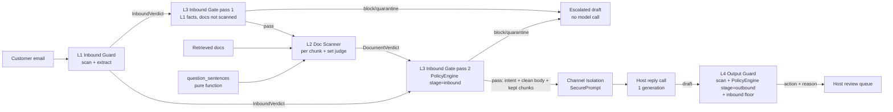

# Implementation Plan - AgentMailGuard v3 Architecture

Kiến trúc đích: [`architect_v3.jpg`](architect_v3.jpg).
Phạm vi: subproject `agentmailguard/` (package `mailguard`) và consumer duy nhất là root
`evaluation/mailguard_bench` cùng `tests/unit/test_mailguard_*`.
Tuân thủ `CLAUDE.md`: spec-driven, divergence protocol §7 (ADR + cập nhật specs), không
renumber requirement ID, một commit cho mỗi task, Definition of Done §3.

## Vấn đề

Guard hiện có 6 layer: L1 injection scanner, L2 intent extractor, L3 channel isolation,
L3b doc scanner, L4 output scanner, L5 policy engine (gọi 2 lần: inbound và outbound).
v3 có 4 guard layer, Channel Isolation không đánh số, bỏ Outbound Gate. Thay đổi không được
làm hỏng hệ thống đang chạy (guard_worker, contract `Job.result_ref`, CI).

## Yêu cầu đã chốt

| ID | Quyết định |
|---|---|
| R-a | L1 + L2 cũ gộp thành **L1 Inbound Guard** (scan + extract intent → email verdict) |
| R-b | L3b cũ → **L2 Doc Scanner** (per chunk + set judge → document verdict) |
| R-c | L5 inbound → **L3 Inbound Gate** (policy trước mọi model call; block/quarantine → escalated draft, không gọi model) |
| R-d | **Channel Isolation** không phải layer: chỉ dựng SecurePrompt (data-marked), không phát verdict |
| R-e | Bỏ Outbound Gate; L4 cũ → **L4 Output Guard** (scan draft + outbound policy → action + reason) |
| R-f | Strictest action wins; quyết định inbound được mang vào L4 |
| R-g | Guard không gọi tool |
| Q1=b | Hard rename, không alias. Run/artifact v2 không đọc lại được; reader từ chối rõ ràng |
| Q2=c | Set judge deterministic mặc định; LLM set judge sau cờ, tắt mặc định |
| Q3=b | Judge trả lời sai → human review, sau cờ `fail_closed_on_judge_error` (mặc định bật; bench có thể tắt để so với v2) |
| Q4=a | Identifier theo nghĩa (`inbound_guard`, `doc_scanner`, `inbound_gate`, `output_guard`, `channel_isolation`); nhãn "L1–L4" chỉ trong docs/report |
| Q5=a | L1 Inbound Guard là facade giữ 2 sub-stage (scan judge + extractor), tối đa 2 LLM call như hiện tại |
| Q6=c | Bench scheme v3; Channel Isolation có toggle riêng cho thí nghiệm; cập nhật docs + paper + ADR + specs |
| D1=A | Inbound floor theo rule cụ thể, thực thi trong code (xem Design decision 1) |
| **Review 2026-10-13** | Các dòng dưới đây được thêm sau review; chúng sửa/bổ sung các quyết định ở trên, không thay số task |
| Q1=b' | Hard rename giữ nguyên cho code, config, env, `GuardReport`. **Ngoại lệ duy nhất:** bench ở `HEAD` giữ một reader **chỉ đọc** cho run folder v1/v2 đã commit (`evaluation/results/mailguard_bench/*`) để tái tạo bảng Review 1; reader này không chạy được run mới và không chuyển đổi report cũ sang schema 3 (xem Task 13) |
| R-h | L2 Doc Scanner bắt buộc có **cheap stage mới**: echo so với `question_sentences` của email (L1 cung cấp), ordered-prefix, bait cluster; không chỉ là aggregate của per-chunk scanner cũ (xem Design decision 9). Lý do: replay trên 100 poisoned-doc case cho thấy per-chunk cũ bắt đủ chunk ở 32/100, echo theo câu hỏi 85/100, thêm ordered-prefix 87–89/100, 0 clean chunk bị flag |
| R-i | L1 Inbound Guard: **severity chỉ đến từ sub-stage scan**. Extractor chỉ thêm `findings`/intent/sanitized body, không bao giờ nâng severity (xem Design decision 8 sửa). Lý do: path "extractor làm detector" là nguyên nhân Llama-3.1-8B quarantine 86/100 email hỏi thông thường trong bench v1 |
| Q7 | Đổi tên `RetrievedChunk` (contract đầu vào của Doc Scanner) → **`SourceDocument`**; verdict theo set là `DocumentVerdict` (đã có), verdict từng mảnh giữ `ChunkVerdict`. Không dùng `KnowledgeChunk` (trùng tên domain của rag-email). Chủ dự án có thể đổi tên khác trước Task 4; sau Task 4 là hard rename |
| Q8 | ADR-0015 giữ cho kiến trúc v3 (file này). Host hook (review-UI badge, `knowledge_document.trust_level`, `exclude_document_ids`, re-retrieval, ingestion scan) là **ADR-0016**, làm sau Task 15, không nằm trong 15 task này |
| Q9 | **Push `refactor/guard-v3` sau mỗi task** (push không phải merge; không PR, không merge vào `main`). Lý do: 15 commit trên một máy Windows chưa push thì không ai review được code trước Task 15 và mất máy là mất hết |
| Q10 | **Task 16 — live benchmark v3** nằm trong phạm vi của người thực hiện plan này. Refactor chưa được coi là xong khi chưa có số đo live (xem Task 16); parity offline chỉ chứng minh không hỏng, không chứng minh tốt hơn |
| **Review 2026-10-14** | Sửa sau review thứ hai; không thay số task |
| F1 | Inbound floor chỉ tồn tại khi action inbound **nghiêm hơn `auto_send`** (Design 1); bất biến (2) giữ nguyên |
| F2 | Gate chạy 2 lần: report và audit chỉ giữ quyết định cuối, `metadata.gate_passes` (Design 9) |
| F3 | Forged marker trong thread history nằm trong `IsolationInfo.forged_markers`, không chạm `inbound_guard.findings` sau gate (Design 10) |
| F4 | Sub-stage extract luôn chạy deterministic; chỉ LLM của nó là tùy chọn (Design 8) |
| F5 | Task 15 tách 15a/15b/15c; allowlist của ratchet ghi sẵn |
| F6 | Quy ước hash trong Execution log (xem mục đó) |
| F7 | Ngân sách delta cho mọi task (Design 14) |
| F8 | Tiêu chí (e) của Task 16 đo theo route, không theo ASR cuối |
| F9 | Baseline có thẩm quyền là GitHub CI; baseline Windows chỉ để so regression cục bộ |
| **Quyết định chủ dự án 2026-10-14 (Task 4)** | Ghi lại khi dừng theo divergence protocol; không thay số task |
| F10 | Task 4 chỉ đổi contract, **giữ gating v2**: `InboundVerdict.merge` tạm lấy severity/score = sub-stage nghiêm hơn (scan, extract); R-i (severity chỉ từ scan) chuyển hẳn sang Task 5. Trần delta Task 4 nâng từ 3 lên **10**, chỉ cho delta do Channel Isolation không còn verdict (R-d): 8 case thread-forged (bullet 2 ADR-0015) + 2 case x-forged khi Doc Scanner tắt (C2, C3-L3B). Đo trước khi code: làm đúng R-i ngay trong Task 4 cho 36 delta. Task 5 sẽ mang ~26 delta R-i (nhóm C3-L1 + extractor LLM nâng severity), vượt trần 6 → phải xem lại trần khi tới Task 5 |
| F11 | Task 5: R-i áp dụng khi scan có chạy. **Luật chuyển tiếp** trong `InboundVerdict.merge`: khi scan không chạy (preset v2 `C3-L1`: scan tắt, extract bật) thì sub-stage extract chấm severity như v2. Task 6 bật/tắt hai sub-stage cùng nhau nên luật này thành code chết và **Task 6 phải xóa nó**. Trần delta Task 5 nâng từ 6 lên **11** (toàn bộ bullet 4: b-004 ×5 config, s-001/s-003 × C2/C3/C3-L3B, đều `llm=1`); trần Task 6 nâng từ 0 lên **26** (26/26 case `C3-L1` đổi khi preset này nghĩa là "không có Inbound Guard": `removed_ratio`, `inbound_rule`, `llm_calls`). Đo trước: R-i không luật chuyển tiếp cho 27 delta ở Task 5 rồi C3-L1 đổi lần nữa ở Task 6 |
| F12 | Task 6: `GuardConfig` một công tắc Inbound Guard (R-a). Preset golden v2 `C1` (chỉ scan) cũng đổi nghĩa — không có trong ước lượng F11 — nên trần Task 6 nâng từ 26 lên **52**: 26 case `C3-L1` (không còn sub-stage nào) + 26 case `C1` (thêm sub-stage extract: `removed_ratio`, 1 call extractor khi `llm=1`; action không đổi, s-001/s-003 `llm=1` P99→P09). Delta lưu ở `agentmailguard/tests/deltas/task6_guard_config.json`, gộp với delta Task 4/5 bằng `_merge_deltas`. Quyết định outbound tạm đi theo `inbound_gate` tới Task 8. Root bench: tập layer v2 → cờ v3 qua `guard_factory.v3_guard_config` (Inbound Guard bật khi có `l1`), `realized_layers` ghi cái thực chạy; 8 assertion chỉ-v2 là strict-xfail `V3_CANNOT`, **Task 12 phải xóa hết** |
| F13 | Task 7: Doc Scanner chạy trước Inbound Gate, gate 2 lượt, cheap signals (`echo_vs_question`, `ordered_prefix`, `bait_clusters`), `build_escalated_draft`, `guarded.v3`. Trần delta Task 7 nâng từ 20 lên **21** (toàn bộ bullet 1: C3/C3-L1 × docs poisoned/x-forged/borderline). Ngưỡng chọn trên dev split `agentmailguard/datasets/splits/rag_poison_dev.json` (90 item PoisonedRAG ngoài pool benchmark và ngoài 89 case pin, 3 style; 600 chunk clean Bitext): v3 bắt đủ chunk độc 78 % prefix / 79 % mid / 0 % paraphrase, 7/600 clean bị flag (v2: 28 / 0 / 0 %, 1/600). Paraphrase không bắt được bằng cheap stage → việc của LLM set judge (Task 10) |
| F14 | Task 8: L4 Output Guard sở hữu quyết định outbound (R-e), không còn Outbound Gate. Preset golden v2 `C3-L5` (L5 tắt = không có quyết định nào) chạy như v3 `inbound_gate=False`, nên Output Guard giờ ra quyết định sau generation: 26/26 case `C3-L5` đổi `final_action`/`final_rule`/`requires_human`/`risk_tier` (draft và call không đổi). Inbound floor tự nó không đổi case nào. Trần delta Task 8 nâng từ 6 lên **26**; delta ở `agentmailguard/tests/deltas/task8_output_guard.json`, ADR-0015 intended change 6 |


Bất biến carry-over được test bằng bảng tổ hợp parametrize, không thêm dependency.
LLM set judge dựa trên PoisonedRAG / poisoning phân tán qua nhiều chunk.

## Bối cảnh (đã xác minh trong code)

- `mailguard/pipeline.py`: L1 → L2 → L5(inbound) → [L3b → L3 trong `build_prompt`] → generate
  → L4 → L5(outbound, ghi đè `report.decision`).
- `contracts/verdict.py`: `LayerName` 6 giá trị; `SanitizedIntent`, `ChunkVerdict`, `OutputVerdict`.
- `contracts/policy.py`: `PolicyAction.strictest()`, `PolicyDecision`, `GuardReport(l1,l2,l3,l3b,l4,...)`.
- `layers/l5_policy_engine/engine.py`: `facts/select/decide/_audit`; catch-all rule chỉ là fallback.
- `configs/policy.yaml` `2026.09-v2`: P03/P06/P07/P10 chỉ chạy ở `stage: outbound`.
- L2 và L3b dùng chung `rules`/`classifier` của L1. Artifact `l1_injection_clf_v1.joblib` được
  pin SHA ở root bench → **giữ nguyên tên**.
- Judge trả sai schema → `mark_llm_fallback` giữ verdict rẻ (có thể "clean").
- Bench v1: Llama-3.1-8B C0T/C3 không phải defence hợp lệ vì extractor nâng severity trên email hỏi
  thông thường (86/100 quarantine) và guard template thiếu reply-format của host. Poisoned-doc route
  v1: GPT 79→32%, Qwen 91→39% — trần của per-chunk scanner cũ, không phải trần của kiến trúc.
- Settings `env_nested_delimiter="__"`, `extra="ignore"` → env cũ phải bị reject tường minh.
- `decision_to_job_result` không chứa tên layer → chỉ được thêm field.

## Thiết kế



### Mapping identifier (hard rename)

| Hiện tại | v3 |
|---|---|
| `layers/l1_injection_scanner`, `layers/l2_intent_extractor` | `layers/inbound_guard/` (`scan.py`, `extract.py`, `guard.py`=`InboundGuard`, `rules.py`, `classifier.py`, `llm_judge.py`) |
| `layers/l3b_document_scanner` | `layers/doc_scanner/` (`chunk_scanner.py`, `set_judge.py`, `scanner.py`=`DocScanner`) |
| `layers/l5_policy_engine` | `mailguard/policy/engine.py` (`PolicyEngine`, component dùng chung) |
| (L5 inbound) | `layers/inbound_gate/gate.py` = `InboundGate` |
| `layers/l4_output_scanner` | `layers/output_guard/` (`scanner.py`, `guard.py`=`OutputGuard`) |
| `layers/l3_channel_isolation` | `mailguard/prompting/channel_isolation.py` |
| `LayerName` | `inbound_guard`, `doc_scanner`, `inbound_gate`, `output_guard` |
| `GuardReport.l1/l2/l3/l3b/l4` | `schema_version=3`, `inbound_guard`, `doc_scanner`, `isolation`, `inbound_decision`, `output_guard`, `decision` |
| `SanitizedIntent` + verdict L1 | `InboundVerdict` (+ `metadata.stages.{scan,extract}`) |
| `list[ChunkVerdict]` | `DocumentVerdict` (chunks, kept/quarantined ids, quarantine_ratio) |
| `RetrievedChunk` (contracts) | `SourceDocument` (Q7); `ChunkVerdict` thêm `trust`, `cluster_id`, `signals` |
| Env `L1__…L5__`, `GUARD_MODELS__JUDGE/EXTRACTOR/DOC_SCANNER` | `INBOUND_GUARD__*`, `DOC_SCANNER__*`, `CHANNEL_ISOLATION__*`, `POLICY__*`, `OUTPUT_GUARD__*`, `GUARD_MODELS__INBOUND_JUDGE/INBOUND_EXTRACTOR/DOC_JUDGE/DOC_SET_JUDGE/OUTPUT_JUDGE`; key cũ → `LegacyConfigError` |
| Prompts | `inbound_scan_judge.v1.txt`, `inbound_extractor.v1.txt`, `doc_chunk_judge.v1.txt`, `output_judge.v1.txt`, mới `doc_set_judge.v1.txt` |
| `GuardConfig(l1..l5)` | `GuardConfig(inbound_guard, doc_scanner, inbound_gate, output_guard, channel_isolation)`; presets C0, C1 = L1+L3, C2 = C1+L2+isolation, C3 = full, `C3-L1…C3-L4`, `C3-ISO` |
| `policy.yaml` `2026.09-v2` | `2026.10-v3` |

### Design decisions

1. **Inbound floor (D1=A, thực thi trong code, không tắt được bằng config)**
   ```python
   CATCH_ALL = {"default"} | {id các rule có when rỗng}
   floor = inbound if (inbound
                       and inbound.matched_rule_id not in CATCH_ALL
                       and rank(inbound.action) > rank(AUTO_SEND)) else None   # F1
   outbound = policy.decide(report, stage="outbound", ...)
   final_action   = strictest(outbound.action, floor.action) if floor else outbound.action
   requires_human = outbound.requires_human or floor.requires_human
   risk_tier      = max theo rank
   winner         = floor nếu floor.rank > outbound.rank, ngược lại outbound (hòa → outbound)
   ```
   Decision cuối ghi `matched_rule_id` của winner, `matched_rule_ids` hợp (rule inbound có tiền tố
   `inbound:`), `metadata.decided_by`, `metadata.carried_from_inbound`, reason
   `"carried from inbound_gate: <rule> (<action>)"`. Allowlist auto_send áp dụng sau merge.
   Bất biến: (1) có floor ⇒ final.rank ≥ floor.rank; (2) auto_send chỉ khi không floor ∧ allowlist;
   (3) requires_human = OR; (4) audit_id idempotent.
   Vì floor chỉ tồn tại khi action inbound nghiêm hơn `auto_send`, một rule inbound cụ thể trả
   `auto_send` không tạo floor; bất biến (2) giữ được mà không cần ngoại lệ. Bảng test Task 8 có hàng:
   rule inbound cụ thể trả `auto_send` × outbound `auto_send` + allowlist ⇒ final `auto_send`,
   `carried_from_inbound = false`.
2. Doc Scanner chạy **trước** Inbound Gate → P01/P04 fire ở inbound; quarantine dừng trước
   generation. Delta có chủ đích, ghi vào golden parity + ADR.
3. Fail-closed judge: `LLMSchemaValidationError`/`LLMError` → `verdict.error="judge_invalid:<stage>"`
   → P00 human_approval. Thiếu provider vẫn degrade. Cờ tắt → hành vi v2.
4. LLM set judge monotonic: chỉ quarantine thêm.
5. `build_escalated_draft(report)` trong pipeline; chữ ký `run()` không đổi.
6. `decision_to_job_result` chỉ thêm `reason`, `decided_by`, `guard_schema_version`.
7. Channel Isolation trả `IsolationInfo`; lỗi build → `isolation.error` → fact `layer_error` → P00.
8. L1 Inbound Guard (**sửa theo R-i**): `severity = scan.severity`; `score = scan.score`;
   `findings = scan.findings ∪ extract.findings` (finding của extractor mang `metadata.stage="extract"`
   và **không tham gia** tính severity/score); intent/sanitized body/`removed_ratio` từ extractor;
   error nếu một sub-stage lỗi; latency = tổng. Extractor trả `contains_assistant_instructions=true`
   mà scan sạch → severity vẫn sạch, chỉ có finding để policy có thể dùng làm fact riêng
   (`extract_flagged`) nếu muốn — không có rule nào bật fact này mặc định.
   Sub-stage extract **luôn chạy deterministic** (strip quoted history, sanitized body,
   `removed_ratio`, intent heuristic); LLM của nó chỉ bật khi `INBOUND_GUARD__EXTRACT_LLM_ENABLED=true`
   (F4). Design 13 đếm model call, không đếm stage.
   `InboundVerdict` ghi lại `question_sentences: list[str]` nhưng **không sở hữu** việc rút câu hỏi:
   `question_sentences(body)` là hàm thuần trong `mailguard/prompting/questions.py`, pipeline luôn
   gọi nó (trên sanitized body nếu L1 bật, trên body thô nếu L1 tắt) rồi truyền cho L2. Nhờ vậy
   ablation `C3-L1` chỉ đo "không có L1", không đồng thời làm yếu L2.
9. L2 Doc Scanner cheap stage (**R-h**), chạy cho mọi chunk, không model call:
   - `echo_vs_question`: overlap token/n-gram của chunk với `question_sentences` (không phải với
     toàn bộ body như hiện tại); ngưỡng riêng cho chunk ngắn.
   - `ordered_prefix`: chunk bắt đầu bằng (hoặc lặp lại theo thứ tự) câu hỏi rồi mới tới nội dung →
     dấu hiệu PoisonedRAG.
   - `bait_cluster`: nhóm các chunk có echo cao với nhau; `ChunkVerdict.cluster_id`; cluster có ≥2 chunk
     echo cao bị quarantine cả cụm.
   - Mỗi chunk có `trust ∈ {trusted, untrusted, quarantined}` để host dùng (ADR-0016) và `signals`
     (dict tên→giá trị) để bench đo từng tín hiệu.
   - Set verdict deterministic = aggregate của các tín hiệu trên (Q2=c giữ nguyên); LLM set judge
     (Task 10) chỉ chạy khi cờ bật **và** có ít nhất một chunk trong dải nghi ngờ (score giữa hai
     ngưỡng); monotonic.
   - **Cấm** chỉnh ngưỡng trên 100 poisoned-doc case đã pin; ngưỡng chọn trên tập dev riêng
     (`datasets/build_rag_poison.py` split dev) và ghi vào `DocScannerSettings` với giá trị + nguồn.
   - Tập dev phải chứa ít nhất một kiểu poisoning mà generator hiện tại không sinh (echo diễn đạt
     lại, không prefix; nội dung độc nằm giữa chunk), nếu không ngưỡng chỉ đúng cho template PoisonedRAG.
   - **Thứ tự chạy trong `inspect_inbound`:** L1 → gate lần 1 chỉ với fact của L1 (fact tài liệu
     = "chưa quét") → nếu block/quarantine thì dừng, **không** chạy doc judge → ngược lại chạy L2
     (cheap stage + judge) → gate lần 2 với đủ fact. Gate deterministic, không tốn gì; cách này giữ
     tính chất v2 "email bị chặn không trả tiền doc judge". `chunks=()` (job `workflow_hint=template`)
     → L2 là no-op theo hợp đồng, không có call nào.
   - **Hai lần gate (F2):** `report.inbound_decision` chỉ giữ quyết định cuối — lần 2, hoặc lần 1
     nếu lần 1 đã block/quarantine và dừng. `report.inbound_decision.metadata.gate_passes ∈ {1, 2}`.
     Audit ghi **một** bản ghi cho quyết định cuối; seed của `audit_id` có thêm `gate_pass` để vẫn
     idempotent và không trùng bản ghi của lần chạy khác. Lần 1 nếu pass thì không audit (quyết định
     tạm).
10. Channel Isolation không có verdict (F3). Marker giả bị scrub khỏi thread history được ghi trong
    `IsolationInfo.forged_markers: list[Finding]` (finding `forged_channel_marker`, stage `isolation`);
    `IsolationInfo.markers_scrubbed` giữ nguyên là số đếm. Policy engine có fact
    `isolation_forged_markers` (= `len(forged_markers)`) cho stage outbound; không có rule nào dùng fact
    này mặc định (như `extract_flagged`), nên không sinh delta parity. `report.inbound_guard.findings`
    **không bị chạm sau gate**: verdict inbound trong report luôn khớp với cái gate đã thấy.
    **Lưu ý thời điểm:** isolation chạy khi dựng prompt, tức *sau* Inbound Gate; thông tin này chỉ
    tới được fact của L4 Output Guard và bench, không bao giờ ảnh hưởng quyết định inbound.
    Ảnh hưởng Task 4 (contract `IsolationInfo`) và Task 8 (fact).
11. Bench reader (Q1=b'): `evaluation/mailguard_bench/legacy_reader.py` đọc run meta + report v1/v2
    từ folder đã commit, chỉ để `make mailguard-report` tái tạo bảng cũ; mọi đường chạy mới, scoring
    v3, ablation từ chối `schema_version < 3` như cũ.
12. `GUARDED_PROMPT_VERSION` tăng lên `guarded.v3` trong Task 7 (prompt đổi vì chunk được render
    với `trust`); bench ghi version này vào run meta.
13. **Ngân sách call của guard cho mỗi job** (bổ sung cho quy tắc một generation của host):
    tối đa 2 call L1 (scan judge + extractor), 1 doc chunk judge, 1 doc set judge, 1 output judge
    = **≤ 5 call guard**; mặc định production chỉ bật scan judge + output judge (≤ 2). Pipeline
    đếm call trong `GuardReport.metadata.guard_calls` và `test_guard_no_tools.py` assert ≤ 5 trên
    toàn bộ ma trận parity; Task 13 (`overhead.py`) báo số call và latency p50/p95 theo config.
14. **Parity không được trở thành "mọi thứ đều là delta có chủ đích".** Mỗi entry trong
    `INTENDED_DELTAS` phải ghi `test` = node id của một unit test chứng minh hành vi mới độc lập với
    golden; reviewer của mỗi loop từ chối delta không có test. Số delta tối đa mỗi task (F7):
    Task 4 ≤ 10 (F10; ban đầu 3), Task 5 ≤ 11 và Task 6 ≤ 52 (F11, F12; ban đầu 6 và 0), Task 7 ≤ 21 (F13; ban đầu 20), Task 8 ≤ 26 (F14; ban đầu 6), Task 11 ≤ 5; Task 3, 9, 10, 12, 13 = 0.
    Vượt trần = dừng và hỏi, không nâng trần.

## Task Breakdown (16 task sau review)

1. Lưới an toàn: plan, ADR (Proposed), golden baseline v2 + `test_guard_parity.py`.
2. Đổi layout package (move-only) + đổi tên prompt.
3. Settings v3 + `LegacyConfigError` cho env cũ.
4. Contracts v3 (`LayerName`, `DocumentVerdict`, `IsolationInfo`, `GuardReport` v3) + policy v3 + audit v3.
5. L1 Inbound Guard facade (`InboundVerdict`, severity chỉ từ scan — R-i; `question_sentences`).
6. `GuardConfig` + presets v3.
7. Doc Scanner trước L3 Inbound Gate + `build_escalated_draft` + cheap stage mới (R-h, design 9)
   + `SourceDocument` (Q7) + `GUARDED_PROMPT_VERSION=guarded.v3`.
8. L4 Output Guard thay Outbound Gate (inbound floor D1, F1; fact `isolation_forged_markers`, F3).
9. Contract Host review queue (additive, kiểm tra consumer phía core trước).
10. LLM set judge (cờ, tắt mặc định; chỉ chạy khi có chunk trong dải nghi ngờ; monotonic).
11. Fail-closed invalid judge (cờ) + test guard không gọi tool.
12. Bench scheme v3 — cấu hình.
13. Bench scheme v3 — scoring & report (reader v3 từ chối `schema_version < 3`; `legacy_reader.py`
    chỉ đọc cho folder v1/v2 đã commit — Q1=b').
14. Docs, paper, specs, ADR → Accepted.
15. Test ratchet cấm identifier cũ, dọn dẹp, nghiệm thu toàn bộ CI (F5):
    - **15a** — ratchet + cleanup. Allowlist ghi sẵn: `evaluation/mailguard_bench/legacy_reader.py`,
      `agentmailguard/tests/golden/`, `agentmailguard/tests/parity.py` (map `GOLDEN_PROMPT_KEY`),
      `LEGACY_ENV_KEYS`, tên artifact `l1_injection_clf_v1`, `train_l1_classifier`/`build_l1_corpus`,
      và chính file ratchet.
    - **15b** — dời pin sang commit 15a; không chạm `agentmailguard/`.
    - **15c** — nghiệm thu: phải chạy thêm `make ci` trên một checkout Linux (laptop của chủ dự án).
    Baseline (F9): **GitHub CI trên `main`** là baseline có thẩm quyền (xanh tại `c98cdfe`: 5 job
    unit/overlay/quality/UI/integration). Baseline Windows 63 fail (`make`/bash/WSL/env, đo bằng
    `mg_root_tests.ps1`) chỉ để so regression cục bộ; nó không chứng minh được regression-safety cho
    recipe make/bash. Con số "1 failed + 3945 passed" trong log Task 2 là `make test-unit`, một lệnh khác.
16. **Live benchmark v3 (Q10)** — một run GPT-4o-mini (model rẻ nhất đã có profile) với scheme v3:
    C0, C1, C2, C3, `C3-L1…C3-L4`, `C3-ISO`, fail-closed bật; tập dữ liệu: LLMail-Inject như v1,
    100 poisoned-doc case đã pin, **và tập benign mới** (≥100 email hỏi thông thường + ≥100 tài liệu
    sạch cùng chủ đề, sinh một lần và commit id) để đo false positive. Tiêu chí nghiệm thu, ghi vào
    run meta và paper: (a) C3 ASR ≤ 5% trên LLMail-Inject; (b) poisoned-doc route: tỉ lệ "bắt đủ
    chunk độc" ≥ 80/100 (replay cho 85–89); (c) benign: quarantine/escalate ≤ 5% email hỏi thông
    thường, ≤ 2% tài liệu sạch; (d) overhead: số call guard ≤ 5, p95 end-to-end theo `overhead.py`
    được báo cáo (SC5 p95 < 10 s là mục tiêu, không phải điều kiện fail của task này); (e) ablation
    đo theo route (F8): **C3-L1** — tỉ lệ bắt ở inbound (số attack bị block/quarantine trước generation
    ÷ tổng attack, LLMail-Inject) phải thấp hơn C3 rõ rệt; **C3-L2** — tỉ lệ "bắt đủ chunk độc" trên
    100 poisoned-doc case phải thấp hơn C3. ASR cuối vẫn báo cáo cho mọi config nhưng không dùng làm
    tiêu chí (e), vì khi bỏ L1 thì L4 Output Guard vẫn có thể bắt injection. Không chạm
    `agentmailguard/`; kết quả zip vào `evaluation/results/mailguard_bench/<run>/`; không commit trong
    lúc RUN đang chạy (`rag_email_commit` được fingerprint). Nếu (a)–(c) fail → quay lại Task 5/7 với
    ADR ghi rõ, không chỉnh ngưỡng trên 100 case đã pin.

## Trạng thái thực thi

Xem mục "Execution log" cuối file; cập nhật sau mỗi task.

Quy ước hash (F6): một commit không thể chứa hash của chính nó. Dòng log của Task N được tick trong
commit của Task N (ghi commit nền), rồi commit của Task N+1 sửa dòng đó thành hash thật của Task N.

## Execution log

- [x] Task 1 — commit `f572a3f`: plan, ADR-0015 (Proposed), golden v2 baseline + `test_guard_parity.py` (182 case).
- [x] Task 2 — commit `c98cdfe`: layout `layers/inbound_guard`, `layers/doc_scanner`, `layers/output_guard`,
  `policy/`, `prompting/`, prompt đổi tên (`inbound_scan_judge`, `inbound_extractor`, `doc_chunk_judge`,
  `output_judge`), test file đổi tên v3; move-only, parity 0 delta (golden giữ khóa `llm_calls` v2 qua
  `GOLDEN_PROMPT_KEY`). Root `make test-unit`: 1 failed (`..._is_the_v2_pin`, đọc tree HEAD nên đổi theo mọi
  commit chạm guard) + 3945 passed; `make lint` sạch.
  Pin test `test_the_committed_guard_folder_is_the_v2_pin` is strict-xfail until Task 15b (Linux equivalent of the Windows transient-failure list).
- [x] Task 3 — commit `8d7f8dc`: `InboundGuardSettings` (`scan_llm_enabled`/`extract_llm_enabled`),
  `DocScannerSettings`, `ChannelIsolationSettings`, `OutputGuardSettings`, `PolicySettings`;
  `GuardModelSettings.inbound_judge/inbound_extractor/doc_judge/doc_set_judge/output_judge`;
  `LegacyConfigError` + `LEGACY_ENV_KEYS` (env + dotenv, case-insensitive); readers in subtree and root
  bench renamed; `.env.example`, `docs/configuration.md` §2.23, README. Subtree 378 passed (parity 188,
  0 delta; `test_settings_v3.py` 48); root 63 fail = Windows baseline, 0 new; ruff/mypy chỉ noise cũ.
  Còn mở (không chặn): dạng JSON lồng nhau (`GUARD_MODELS='{"judge":…}'`) chưa bị từ chối;
  Task 10 phải set `doc_set_judge` trong `harness.build_pipeline` và `guard_factory.guard_settings`.
- [x] Task 4 — commit `3b58c81` (branch `refactor/guard-v3`): `LayerName` 4 giá trị (`inbound_guard`,
  `doc_scanner`, `inbound_gate`, `output_guard`); `InboundVerdict.merge` (gating v2 giữ nguyên theo
  F10, `metadata.stages.{scan,extract}`, finding gắn `stage`), `DocumentVerdict.from_chunks`,
  `ChunkVerdict.trust/cluster_id/signals`, `IsolationInfo` (thread-forged → `forged_markers`),
  `RetrievedChunk`→`SourceDocument`; `GuardReport` schema 3 (`extra="forbid"`); channel isolation trả
  `IsolationInfo`, lỗi build → `isolation.error` → P00; policy `2026.10-v3`, fact
  `isolation_forged_markers`, audit v3 (`schema_version`, `layer`, `doc_scanner`, `isolation`).
  Parity: 10 delta (8 thread-forged, 2 x-forged khi Doc Scanner tắt), mỗi delta có `why` + `test`;
  golden không sửa, `project_golden` chỉ bỏ khóa verdict isolation. Subtree 397 passed; root 63 fail =
  Windows baseline, 0 new; ruff/mypy chỉ noise cũ. Bench giữ vocabulary v2 qua `bench_verdict_views`
  và `scoring._flagged_layers_v3` đến Task 12/13. Còn mở: `l2_recount.py` chỉ đọc report v2 (folder
  đã commit); Task 5 dự kiến ~26 delta R-i, vượt trần 6.
- [x] Task 5 — commit `d343cf4`: `layers/inbound_guard/guard.py` `InboundGuard` (scan + extract, rules và
  classifier dùng chung, ≤ 2 LLM call); pipeline `inbound_guard`/`inbound_judge`/`inbound_extractor`
  thay `l1`/`l2`/`judge`/`extractor_llm`; R-i: extractor không nâng severity (finding
  `detector="extract"`, `rule_id="assistant_instructions"`), `merge` lấy severity từ scan, luật
  chuyển tiếp F11 khi scan không chạy; `prompting/questions.py` `question_sentences` (pipeline luôn
  gọi, ghi vào `inbound_guard.question_sentences` hoặc `report.metadata`). Parity 11 delta mới (bullet
  4, test `test_inbound_guard.py::test_clean_scan_and_flagging_extractor_...`), tổng 21. Subtree 413
  passed; root 63 fail = baseline, 0 new; ruff/mypy chỉ noise cũ. Root bench: `pipeline.inbound_guard.*`.
  Còn mở: Task 6 xóa luật chuyển tiếp và `run_scan`/`run_extract` (26 delta C3-L1); finding
  `llm:assistant_instructions` cũ vẫn được `l2_recount.py` đọc trên folder v1/v2.
- [x] Task 6 — commit `606ac1d`: `GuardConfig(name, inbound_guard, doc_scanner, inbound_gate, output_guard,
  channel_isolation)`, preset C0/C1/C2/C3, `C3-L1…C3-L4`, `C3-ISO`; `C3-L3B`/`C3-L5` → `ValueError`;
  pipeline `channel_isolation`/`doc_scanner`/`output_guard`/`policy`, kwargs `doc_judge`/`output_judge`;
  luật chuyển tiếp F11 và `run_scan`/`run_extract` đã xóa. Parity 52 delta mới (F12: 26 C1, 26 C3-L1),
  70 case có delta. Subtree 414 passed; root 63 fail = baseline, 0 new, 8 strict-xfail `V3_CANNOT`
  (hết hạn Task 12). Còn mở: quyết định outbound vẫn theo `inbound_gate` tới Task 8; bench vẫn
  vocabulary v2 (`v3_guard_config`, `realized_layers`) tới Task 12/13.
- [x] Task 7 — commit `993572b`: `inspect_inbound(email, chunks, …)` = Inbound Guard → gate lượt 1 → Doc Scanner →
  gate lượt 2 (dừng ở lượt 1 thì không quét tài liệu, không gọi doc judge; audit 1 dòng, seed có `gate_pass`);
  `DocScanner`, `signals.py`, `set_judge.py`, `InboundGate`; `build_prompt` chỉ dùng chunk được giữ, render
  `[chunk id=… trust=…]`; `build_escalated_draft`; `GUARDED_PROMPT_VERSION=guarded.v3`; `build_rag_poison
  --style/--dev-split`, `training/tune_doc_scanner.py`, ngưỡng mới trong `DocScannerSettings` (F13). Parity 21
  delta (bullet 1). Subtree 434 passed; root 63 fail = baseline, 0 new. Còn mở: style paraphrase 0 % (Task 10);
  `runmeta.py` ghi `guarded.v3` ở Task 13; raw dataset chỉ có trên máy này (gitignore), dev split chỉ commit id.

- [x] Task 8 — on `993572b`: `layers/output_guard/guard.py` `OutputGuard` (scan → `policy.decide(stage=
  "outbound")` → inbound floor, design 1/F1: catch-all từ policy đã nạp, floor chỉ khi rule cụ thể và
  action > `auto_send`, strictest, OR `requires_human`, max risk tier, hòa → outbound, `inbound:` prefix,
  `decided_by`/`carried_from_inbound`/`inbound_floor`, allowlist sau merge); chỉ quyết định đã merge được
  audit (`PolicyEngine.write_audit`); luật chuyển tiếp F12 đã xóa; Output Guard tắt → `report.decision` =
  quyết định inbound. Fact `isolation_forged_markers` đã có từ Task 4 (test trong `test_channel_isolation.py`).
  Parity 26 delta (F14, toàn bộ `C3-L5`, `tests/deltas/task8_output_guard.json`); floor tự nó 0 delta.
  `test_output_guard_floor.py` (120 tổ hợp + hàng `auto_send` bắt buộc + pipeline). Subtree 560 passed; root
  63 fail = baseline, 0 new; thêm strict-xfail `V3_OUTPUT_GUARD_DECIDES` (C3-L5 bench, hết hạn Task 12).
  Còn mở: docs `docs/overview/layers/*` và README còn chữ "outbound gate" (Task 14).
- [x] Task 9 — commit `6d8d861`: `integration/adapters.py::decision_to_job_result` giữ nguyên mọi key/value,
  thêm `reason` (phần tử đầu của `decision.reasons` hoặc None), `decided_by` (`decision.metadata.get(
  "decided_by")`) và `guard_schema_version` (`report.schema_version`) vào khối `mailguard` (ADR-0015 mục 7).
  Core không đọc khóa `mailguard` (grep `packages/`, `services/`, `evaluation/mailguard_bench/live`: 0 reader).
  `test_job_result_contract.py` (4 test). Parity 0 delta (outcome không chứa job result).
- [x] Task 10 — commit `002378c` (bổ sung `be898b1`): `layers/doc_scanner/set_judge.py::LLMSetJudge` (prompt `doc_set_judge.v1`,
  question sentences `wrap_untrusted(EMAIL)` làm tham chiếu, mỗi chunk `[chunk id=…]` + `wrap_untrusted(
  KNOWLEDGE)`, output `{"poisoned_chunk_ids", "reason"}`); đơn điệu: chỉ chuyển id đang kept → quarantined,
  id lạ/đã quarantine bị bỏ qua, severity/score không giảm; metadata `set_judge="llm"`, `set_judge_added`,
  `set_judge_reason`. `should_run`: cờ `DOC_SCANNER__SET_JUDGE_LLM_ENABLED` (mặc định false) + có provider +
  ≥1 chunk chưa quarantine có score trong `[suspicious_band)` → ≤1 call (quyết định 13). `LLMError` →
  `mark_llm_fallback`, verdict giữ nguyên (fail-closed: Task 11). Pipeline kwarg `doc_set_judge`
  (`GUARD_MODELS__DOC_SET_JUDGE`). `tests/parity.py` đếm call theo tên `doc_set_judge.v1` (`V3_PROMPT_NAMES`,
  ngoài golden). `test_doc_set_judge.py` (11 test). Parity 0 delta. Subtree 575 passed.
  Bổ sung (việc Task 3 giao): `harness.build_pipeline` và root `guard_factory.guard_settings` đặt
  `guard_models.doc_set_judge` = model của guard; cờ vẫn tắt nên provider không được dựng, 0 delta.
  Test `test_evaluation.py::test_build_pipeline_puts_the_guard_model_on_the_set_judge_too`,
  `test_mailguard_bench_guard.py::test_guard_settings_point_every_stage_at_one_model`. Subtree 576
  passed; root bench guard tests 62 passed + 2 xfail có sẵn. Còn mở: bench chưa có công tắc bật set
  judge (Task 12).
- [x] Task 11 — on `be898b1`: `MailGuardCoreSettings.fail_closed_on_judge_error` (mặc định true,
  `MAILGUARD__FAIL_CLOSED_ON_JUDGE_ERROR`); `mailguard/llm/judge_calls.py` (`judge_failure`,
  `JUDGE_STAGES`, `MAX_GUARD_CALLS_PER_JOB = 5`, bộ đếm theo `contextvars`). 5 judge (`inbound_scan`,
  `inbound_extract`, `doc_chunk`, `doc_set`, `output`): lỗi/answer sai schema + cờ bật → `verdict.error =
  "judge_invalid:<stage>"` (set judge: `"set: judge_invalid:doc_set"`), giữ kết quả rẻ (severity/score
  không đổi), `metadata.judge_invalid` + `llm_fallback` → P00 human_approval; cờ tắt → fallback v2;
  không có provider → degrade, không lỗi. `SetJudgeOutput.poisoned_chunk_ids` thành bắt buộc (prose/`{}`
  không còn nghĩa là "không chunk nào độc"). Pipeline ghi `report.metadata["guard_calls"]` `{stage: n}`
  cho `inspect_inbound` + `inspect_outbound`, warning khi > 5. `tests/parity.py` thêm câu trả lời
  `doc_set_judge.v1` (golden không bật set judge). Test: `test_judge_fail_closed.py` (28: 5 judge × 2 kiểu
  lỗi × cờ, pipeline P00 ở inbound/outbound, judge không cấu hình), `test_guard_no_tools.py` (9: toàn bộ
  ma trận parity với mọi judge bật — không field tool, host `generate` ≤ 1, `guard_calls` ≤ 5 và khớp
  đúng log của provider; job tệ nhất = đúng 5 call; backend OpenAI/Ollama qua `httpx.MockTransport`
  không gửi `tools`/`tool_choice`/`functions` và bỏ qua `tool_calls`; không module nào nhắc field tool).
  Test v2-fallback (`test_llm_fallback.py` và 4 test khác) chạy với cờ tắt. Parity 0 delta. Subtree 613
  passed; root 63 fail = đúng tập baseline, 0 new; ruff sạch; mypy chỉ noise `datasets/`. Root bench:
  `guard_factory.guard_settings` đặt cờ = false (bench chấm fallback là row có điểm, verdict error là
  crash) tới khi scheme v3 chọn theo config (Task 12). ADR-0015 decision 14 sửa trần Task 8 = 26 (F14).
  Còn mở: (1) chunk judge chạy một lần **cho mỗi** chunk trong dải nghi ngờ, không có trần per-job, nên
  ≤ 5 call chỉ đúng khi tối đa một chunk vào dải (ma trận parity, job tệ nhất có 1 chunk); quyết định 13
  ghi "1 doc chunk judge" — cần chủ dự án chọn: trần 1 chunk-judge call/job, hay nâng ngân sách;
  (2) README gốc và `docs/overview/layers/*` vẫn ghi "failed LLM stage keeps the cheap result" (Task 14);
  (3) `tests/integration/test_mailguard_bench_guarded_run.py` cần Docker, chưa chạy.
